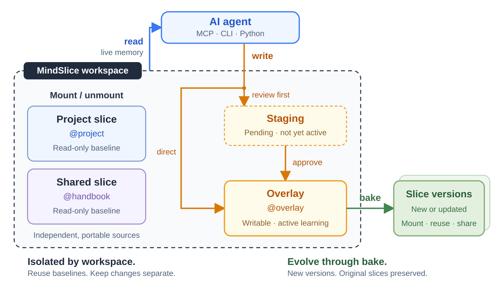

# MindSlice

**Portable memory for AI agents, with isolation and evolution built in.**

Keep project knowledge, personal preferences and shared handbooks in plain Markdown.
Mount what an agent needs, let it learn in its own workspace, and bake those learnings
into reusable versions. Connect through MCP, the CLI or Python.



## Why MindSlice?

**Isolation.** A *slice* is a folder of Markdown cards you can mount, unmount and share
independently. Mounted slices stay read-only through the engine; new learning goes into
a separate overlay. Multiple workspaces can reuse the same baseline while keeping their
own changes. Pending edits stay outside live memory until approved.

**Evolving memory.** Cards can explicitly extend or supersede earlier knowledge, so
retrieval follows recorded relationships under your trust rules. `bake` turns selected
changes into new slice versions, preserving the original folders and returning the new paths.

[Hot/cold memory](https://docs.letta.com/v1-sdk/memory/context-hierarchy) focuses on what stays
in context and what is retrieved later. [LLM Wiki](https://gist.github.com/karpathy/442a6bf555914893e9891c11519de94f)
focuses on compiling sources into a maintained knowledge base. MindSlice makes **memory
boundaries and controlled evolution** first-class engine operations.
[How these approaches fit together →](https://github.com/pancerZH/MindSlice/blob/main/docs/concepts.md)

Python 3.12+. No runtime dependencies, database server or LLM API calls inside the engine.

## Get started

Paste this into your coding agent:

```text
Install MindSlice (`pipx install mindslice` or `uv tool install mindslice`),
then read https://raw.githubusercontent.com/pancerZH/MindSlice/main/skills/mindslice-setup/SKILL.md to finish setup.
```

The agent helps you choose a workspace, connect your app, and choose how to start:

| Starting point | Tool |
| --- | --- |
| Empty memory or a short conversation | MindSlice `init` and ordinary memory writes |
| Existing MindSlice workspace | Connect it directly with `-w` |
| Shared `.slice` or Markdown notes folder | MindSlice `mount`, indexed as is |
| Documents to distill into structured cards | [MindSlice-forge](https://github.com/pancerZH/MindSlice-forge) |

Forge is an optional document-conversion tool. It creates a new workspace using an agent harness;
MindSlice handles storage, retrieval, mounting and memory evolution without needing Forge or an LLM.
The [builder skill](https://github.com/pancerZH/MindSlice/blob/main/skills/slice-builder/SKILL.md) guides conversion and integration with an existing workspace.

Prefer manual setup? With Python 3.12+ and [pipx](https://pipx.pypa.io/) (or [uv](https://docs.astral.sh/uv/)) installed:

```bash
pipx install mindslice   # or: uv tool install mindslice
mindslice init ~/mindslice
```

*(For local development from source: `git clone https://github.com/pancerZH/MindSlice.git && cd MindSlice && pipx install -e .`.)*

Then [connect your agent](https://github.com/pancerZH/MindSlice/blob/main/docs/getting-started.md#connect-your-agent) and tell it what to remember.
Run `mindslice -w ~/mindslice doctor`, then [verify a new session](https://github.com/pancerZH/MindSlice/blob/main/docs/getting-started.md#verify-your-first-session).
[Full setup guide](https://github.com/pancerZH/MindSlice/blob/main/docs/getting-started.md) · [Review changes and bake slices](https://github.com/pancerZH/MindSlice/blob/main/docs/workflow.md)

## Documentation

- [Concepts](https://github.com/pancerZH/MindSlice/blob/main/docs/concepts.md) — isolation, evolution, and how MindSlice fits other memory architectures.
- [Reference](https://github.com/pancerZH/MindSlice/blob/main/docs/reference.md) — commands, Python API, MCP tools and card formats.
- [History and recovery](https://github.com/pancerZH/MindSlice/blob/main/docs/history-and-recovery.md) — explain memory, roll back slices, back up and restore workspaces.
- [Build slices with Forge](https://github.com/pancerZH/MindSlice/blob/main/skills/slice-builder/SKILL.md) — convert documents and connect the resulting workspace or slices.
- [Maintain memory](https://github.com/pancerZH/MindSlice/blob/main/skills/slice-maintainer/SKILL.md) — consolidate knowledge and repair relationships.
- [Evaluations](https://github.com/pancerZH/MindSlice/blob/main/docs/evaluations.md) · [Design](https://github.com/pancerZH/MindSlice/blob/main/docs/design.md) · [Uninstall](https://github.com/pancerZH/MindSlice/blob/main/skills/mindslice-setup/uninstall.md)

## License

[Apache License 2.0](https://github.com/pancerZH/MindSlice/blob/main/LICENSE). Benchmark excerpts quoted in the evaluation records keep their
datasets' licences; see [NOTICE](https://github.com/pancerZH/MindSlice/blob/main/NOTICE).
